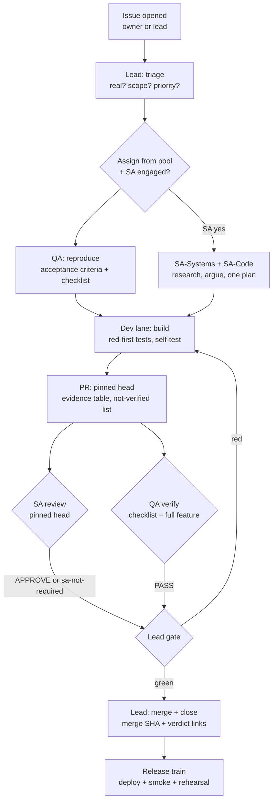

# The xQA team — four seats and a pool

This is the operating shape of the people and agents who build xQA. `ISSUE-FLOW.md` says what happens to an
issue; this document says **who sits where**, what each seat may decide, and what it may never do. When the two
disagree, `ISSUE-FLOW.md` wins on the steps and this file wins on authority.

## 1. Why this shape

The team is small, the machine is one Mac, and the work is one repository. Three failure modes have already
been paid for here, and the shape is designed against them:

| Failure we saw | What caused it | What prevents it now |
|---|---|---|
| A lead that writes the fix and then merges it | The lead was also a dev lane | The lead does not implement code in an issue it will merge (§3) |
| "QA" that is the author, or nobody | No standing QA seat; verification fell to SA, lead or the owner | One QA seat that never writes product code, and only QA sets the QA gate (§4) |
| Seven lanes at once on one Mac | Assignment by ambition, not by capacity | A hard WIP limit owned by the lead (§5) |
| Two agents re-deriving the same context | No handoff contract between seats | Every stage leaves a file, not a chat message (§8) |

It is deliberately **not** a swarm: one merge authority, one queue, one owner interface. It is also not a
stateless pipeline: reproducing a UI defect and exploring a feature as a user need judgment and a loaded
context, which a fresh agent per step cannot supply.

## 2. The seats

| Seat | Kind | Owns | Never | Main artifact |
|---|---|---|---|---|
| **Lead / Integrator** | standing | triage, lane assignment, SA engagement, queue and WIP, merge, close, release, owner interface | implementing code in an issue it will merge; setting the QA gate | triage comment, merge SHA |
| **QA** | standing | reproduction before work, acceptance criteria and developer checklist, independent verification after the build, full-feature and side-effect exploration | writing product code, designing architecture, widening scope silently | QA acceptance, QA verification |
| **SA-Systems** | standing, on demand | contracts, data model, boundaries, migrations, infra, providers, security, quotas, failure semantics, system performance | implementing, approving a head it did not read, duplicating SA-Code's review | system findings + joint plan |
| **SA-Code** | standing, on demand | thin modules, reuse, callers, tests, diff size, maintainability, code-level performance | product semantics, system architecture, style-only nitpicks as blockers | code findings + joint plan |
| **Dev lane** | pool, per issue | one issue: smallest change, red-first tests, self-test on QA's checklist, evidence, PR | pushing `main`, merging, closing, changing scope, touching another lane's files | branch + PR + evidence log |
| **Release train** | hat of the lead | freeze, merge order, deploy, Prod smoke, rehearsal, rollback | releasing without the owner's window or with a red gate | release issue + runbook run |

A seat is a **session with a skill**, not a job title. A person can hold two seats in different issues, but
never the author and the verifier of the same issue.

## 3. The flow



Two rules make the diagram true rather than decorative:

1. **Nobody certifies their own work.** The lane that wrote the code cannot set a gate. The lead cannot set
   the QA gate. SA cannot approve a head it did not read.
2. **A verdict pins a head.** If the branch moves, the changed part is reviewed again; an old APPROVE does not
   carry over.

## 4. Gate authority

The gate labels are the only thing that can close an issue, and each one has exactly one writer. The
automation (`scripts/issue-flow.mjs`) keeps the label set consistent; the table keeps the humans honest.

| Label | Written only by | Requires |
|---|---|---|
| `gate:sa-systems-approved` | SA-Systems | a review of the pinned head, with the mandatory performance section |
| `gate:sa-code-approved` | SA-Code | a review of the pinned head, with test and caller evidence |
| `gate:qa-passed` | QA | independent reproduction and the item-by-item checklist on the build SHA |
| `sa-not-required` | Lead | a recorded reason; mechanical changes only |
| `status:merged` | Lead | the merge SHA |
| `owner-override` | Owner (through the lead) | the reason, in writing, on the issue |

## 5. WIP, queue and the machine

The physical limit is the Mac: Docker, Postgres, the API, the worker and a browser do not multiply. The
policy is capacity-based, not ambition-based.

- **2 dev lanes building** at once, maximum. A third issue waits in the queue.
- **1 heavy job at a time** — a full test run, a build, a from-empty rehearsal, a browser grid session.
- **Idle beats thrashing.** A lane with no runnable work stays idle; it does not start "while I'm here" work.
- **The lead owns the queue.** If an issue is urgent and no lane is free, the lead either displaces a lane
  (recorded) or asks the owner to add one. Adding a Claude lane needs the owner's approval.
- **Blocked work leaves the build slot.** A lane waiting on a review is free; a lane waiting on a stack it
  must keep alive still occupies memory and is counted.

## 6. When SA is engaged

The lead decides at triage and records the answer. SA is **engaged** when the change touches:

- a contract in `app/document/_api/`, the fixture/data-set model, or a shared schema;
- the database: a table, a column, a migration, a backfill;
- a boundary: provider transport, worker/queue, browser grid, auth, tenancy, secrets;
- performance in a way a user will feel (passes, reads, latency, memory, cost per run);
- a design that is not obvious from the issue, or two reasonable implementations with different
  consequences.

SA is **not engaged** for a mechanical fix whose shape the issue already pins, a test-only change, a copy or
layout change with a pinned reference, or a revert. The lead writes `sa-not-required` with the reason; QA's
checklist still gates the change.

When SA is engaged, both seats review. One round of findings each, then a joint plan. A deadlock goes to the
lead; a decision that changes behaviour, data, money or the release goes to the owner **before** the lane
starts.

## 7. Escalation ladder

| Situation | Decides | Records |
|---|---|---|
| A checklist item needs a small deviation with the same observable result | Dev lane | the deviation and why, in the PR |
| A real behaviour, contract, data-model or migration change | SA pair, then lead confirms | joint plan on the issue |
| Two SAs disagree | Lead | the decision and the losing argument |
| QA finds a side effect outside the issue's scope | QA files a new issue; lead assigns | link from the original |
| A finding blocks the release | Lead + owner | fix-forward or rollback, in writing |
| Security, secrets, tenant data, billing, Prod window | Owner, always | on the issue |

## 8. Handoffs are files, not messages

A seat that finishes work leaves behind something the next seat can read without asking. Chat context does not
survive a session; a file does.

| From → to | Artifact | Template |
|---|---|---|
| Owner/lead → team | issue body | `docs/process/templates/issue.md` |
| Lead → QA/dev | triage comment (lane, SA decision, priority) | issue body §5–§6 |
| QA → dev | reproduction + acceptance criteria + checklist | `docs/process/templates/qa-acceptance.md` |
| SA → dev/lead | findings + joint plan + performance section | `docs/process/templates/sa-systems-review.md`, `sa-code-review.md` |
| Dev → SA/QA | PR with pinned head and evidence table | `docs/process/templates/pr.md` |
| QA → lead | PASS/FAIL with build SHA and item table | `docs/process/templates/qa-verification.md` |
| Lead → release | merge SHA + verdict links | issue close comment |
| Release → owner | smoke and rehearsal numbers, rollback path | `docs/process/runbook` (per release) |

Every artifact carries: **date/time, actor, pinned head SHA, what ran, result, artifact path**. Numbers, not
adjectives. No secret, key, token, password or raw environment dump — the automation refuses text that looks
like one.

## 9. Starting a seat

A seat is a Claude session in a worktree of this repository, with the seat's skill loaded. The skill carries
the procedure; this document carries the authority.

| Seat | Skill | Works in |
|---|---|---|
| Lead | `xqa-lead` | the integration checkout |
| QA | `xqa-qa` | its own worktree, with a runnable stack |
| SA-Systems | `xqa-sa-systems` | read-only review checkout |
| SA-Code | `xqa-sa-code` | read-only review checkout |
| Dev lane | `xqa-dev-lane` | one worktree per issue |
| Release | `xqa-release` | the integration checkout, with Prod access |

The skills live in `.claude/skills/` and are committed, so every worktree has them. The first read for any seat
is `CLAUDE.md` (cold start), then this file, then the seat's skill.

### One command from a cold machine

```bash
npm run team:up
```

It reads the GitHub board with `gh` (the `repo` scope is required), prints it, opens or reuses the **lead**
terminal in the integration checkout, and hands it the triage prompt. It starts no lane and makes no decision:
the lead does that, on the board, under the WIP limit.

- `--dry-run` prints the board and the exact prompt; it starts nothing.
- `--agent codex` launches the lead with another provider.
- `--fresh` opens a new lead terminal when the existing one is busy.
- `--here` keeps the current worktree instead of resolving to the integration checkout.

The lead is the Orca **root coordinator**: it creates the Run and dispatches workers, and it is never itself
dispatched — a supervised worker cannot start the rest of the team because nested dispatch depth is 1 by
default.


## 10. Changing this document

This is the backbone while it works. Change it the way the product changes: a small issue, a reason, and a
review — not a rewrite in a conversation. If a seat is added or removed, the README diagram moves in the same
commit.
